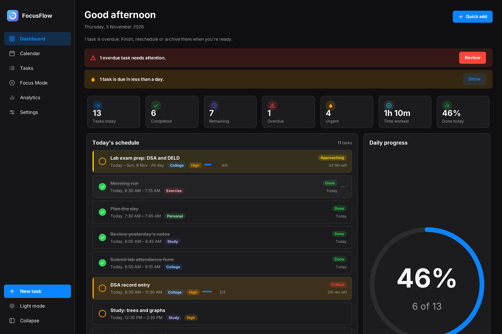
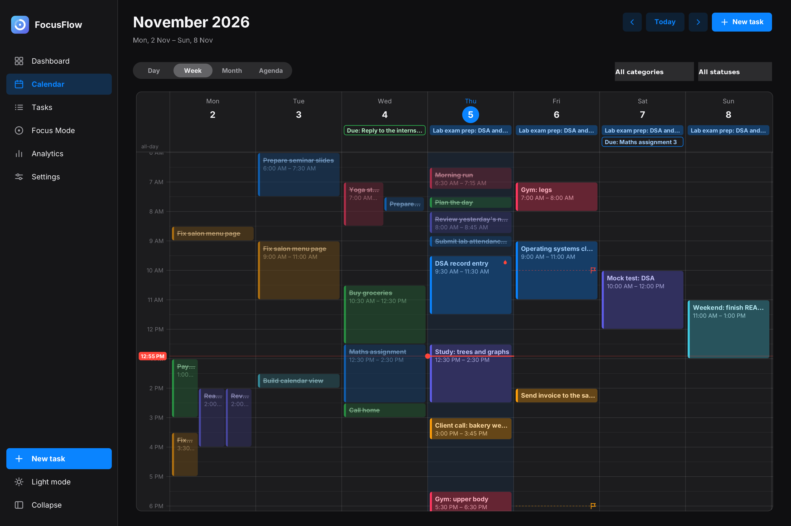
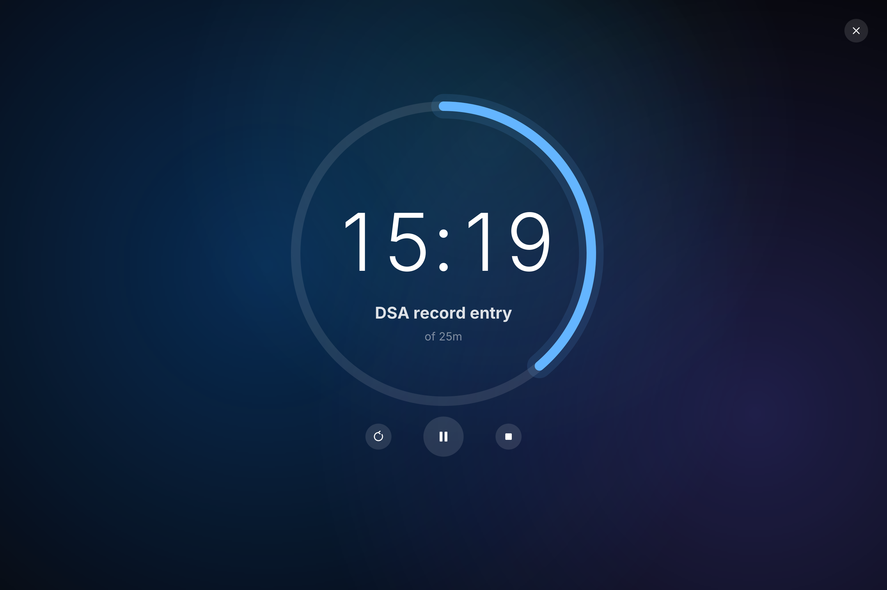
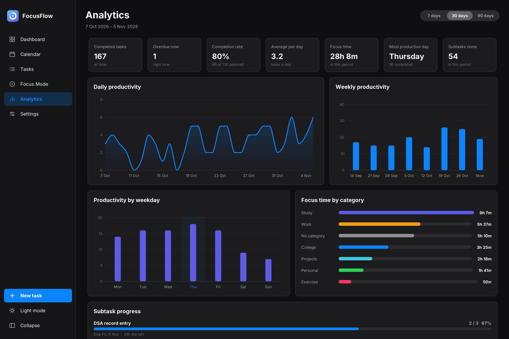

<div align="center">

# FocusFlow

**A calendar, task manager and focus timer that tells you which deadline to worry about first.**

Fast. Private. Works fully offline on Windows.


[**Download the latest version**](https://github.com/YOUR-USERNAME/FocusFlow/releases/latest)



</div>

---

## Why I built it

Most to-do apps treat "do this at 3 PM" and "this is due Friday" as the same thing. They are not.
Studying for an exam is not a one-hour block, it is work you have to spread across days before a deadline.

FocusFlow keeps the two ideas separate:

* **Schedule**: when you plan to work on something (a time slot, a whole day, or several days).
* **Deadline**: when it must be finished. FocusFlow watches it and tells you how worried to be.

## Download and install

1. Go to the [**Releases** page](https://github.com/YOUR-USERNAME/FocusFlow/releases/latest).
2. Download `FocusFlow-1.0.0.exe`.
3. Double-click it and follow the installer. No Java needed, it is bundled.

> **Windows says "Windows protected your PC"?**
> The installer is not code-signed (certificates cost money). Click **More info**, then **Run anyway**.
> The full source code is in this repository if you want to check it or build it yourself.

Your tasks are stored on your own computer, in `%APPDATA%\FocusFlow`. Nothing is uploaded anywhere.

## Features

### Calendar
* Day, week, month and agenda views.
* Click or drag on an empty slot to create a task. Drag a task to move it. Drag its bottom edge to resize it.
* Overlapping events sit side by side, with a live "now" line and an all-day row.
* All-day tasks can span several days, perfect for exam prep.
* Filter by category and status.



### Deadline intelligence
Every task with a deadline gets a level and a score from 0 to 100.

| Level | Default meaning |
| --- | --- |
| Comfortable | more than 7 days left |
| Approaching | 3 to 7 days |
| Urgent | 24 to 72 hours |
| Critical | under 24 hours |
| Overdue | the deadline has passed |

The score is not just a countdown. It weighs:

* **Time left** until the deadline.
* **Remaining work**: your estimate, minus finished subtasks, minus time you already scheduled.
* **Priority**.

So a task due in 3 days that needs 8 hours ranks higher than one due in 3 days that needs 15 minutes.
Card colours shift from green to red as the score rises. It is an estimate to help you plan, not a prediction.
Thresholds can be changed in Settings.

### Tasks
* Categories (create, rename, recolour, delete), priorities and statuses.
* Subtasks with an automatic progress bar.
* Recurring tasks, archive, reschedule, extend a deadline, and undo for most actions.
* Global search with `Ctrl+K`.

### Power Mode (focus timer)
* Preset or custom duration, optionally linked to a task.
* A distraction-free full-window countdown with a circular progress ring.
* Survives minimising and even closing the app, because it counts from saved timestamps.
* Every session is saved. It never marks your task complete for you.



### Dashboard and analytics
* Today at a glance: tasks, overdue, urgent, time worked, daily progress.
* Weekly and monthly graphs, task distribution, completion and on-time statistics.
* Subtask progress for every open task, focus time by category, most productive day.



### Everything else
* Light and dark themes with smooth transitions, and a reduced-motion option.
* Reminders for deadlines, scheduled starts, overdue tasks and finished focus sessions, with no spam.
* System tray support and optional launch at Windows startup.
* Automatic daily backups, manual backup and restore, CSV and JSON export.

## Keyboard shortcuts

| Shortcut | Action |
| --- | --- |
| `Ctrl+N` | New task |
| `Ctrl+K` | Search |
| `Ctrl+T` | Jump to today |
| `Ctrl+Z` | Undo |
| `Ctrl+D` | Toggle dark mode |
| `Ctrl+B` | Collapse the sidebar |
| `Ctrl+1` to `Ctrl+6` | Switch section |
| `Left` and `Right` | Move around the calendar |
| `Space` | Pause or resume the timer |

## Privacy

* No account, no login, no analytics, no internet connection needed.
* Everything is stored in one SQLite file: `%APPDATA%\FocusFlow\focusflow.db`.
* Backups live in `%APPDATA%\FocusFlow\backups`. Delete the folder to remove all your data.

## Build from source

You need **JDK 21** and **Maven**.

```bat
git clone https://github.com/YOUR-USERNAME/FocusFlow.git
cd FocusFlow
run.bat
```

`run.bat` builds the app on first launch and then opens it. Other scripts:

| Script | What it does |
| --- | --- |
| `build.bat` | Builds `target\focusflow.jar` |
| `create-shortcut.bat` | Adds a Desktop and Start menu shortcut |
| `package-installer.bat` | Builds the Windows installer with `jpackage` (needs [WiX Toolset 3.x](https://github.com/wixtoolset/wix3/releases)) |

## How it is built

| Part | Choice |
| --- | --- |
| Language | Java 21 |
| UI | Swing with [FlatLaf](https://www.formdev.com/flatlaf/), and custom Java2D painting for the calendar, charts and animations |
| Database | SQLite through the xerial JDBC driver, in WAL mode |
| Build | Maven (shaded jar), `jpackage` for the installer |

A few design decisions worth knowing:

* **Layers**: UI, services (business rules), repositories (SQL). The UI never talks to the database directly.
* **In-memory task cache**: the app reads tasks from memory and writes each change to SQLite inside a transaction.
* **One animation clock**: every animation shares a single timer that sleeps when nothing moves. Motion uses spring physics so it can be interrupted smoothly.
* **Wall-clock timer**: the focus countdown is computed from timestamps, never from counting ticks, so it stays correct across sleep, minimise and restart.
* **Safe data handling**: versioned schema, automatic daily backups, and restore always saves a copy of your current data first.

```
com.focusflow
  app            entry point and service registry
  database       connection, transactions, schema versions
  models         Task, Subtask, Category, FocusSession, Urgency
  repositories   SQL for each table
  services       tasks, urgency, analytics, focus timer, backup
  notifications  reminders and system tray
  animations     shared animation clock and springs
  ui             window, sidebar, theme and one package per section
```

## Known limitations

* Windows only for now.
* The installer is unsigned, so Windows shows a warning on first run.
* English only, and times are shown in 12-hour format.
* No cloud sync. Each computer keeps its own data (use backup and restore to move it).

## Roadmap

- [ ] Hours studied versus hours needed progress for a task
- [ ] 24-hour time option
- [ ] Import from CSV
- [ ] Task templates

## Contributing

Bug reports and ideas are welcome. Please open an [issue](https://github.com/YOUR-USERNAME/FocusFlow/issues)
and include what you did, what you expected, and the file `%APPDATA%\FocusFlow\error.log` if it exists.

## Credits

Built with [FlatLaf](https://www.formdev.com/flatlaf/) (Apache 2.0), [SQLite JDBC](https://github.com/xerial/sqlite-jdbc) (Apache 2.0)
and [SLF4J](https://www.slf4j.org/) (MIT). Design inspired by Apple's Human Interface Guidelines.

## License

[MIT](LICENSE) © 2026 Shibil
